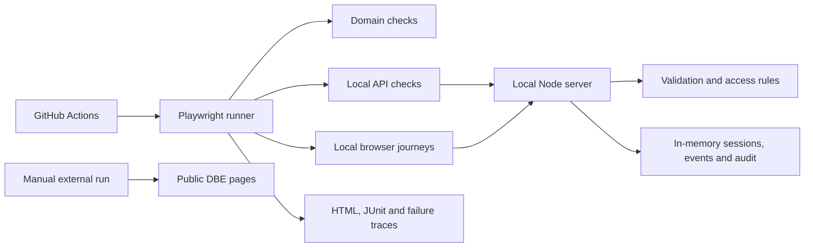

# QE Lab architecture

The Playwright `webServer` starts `scripts/mock-api-server.cjs` on `127.0.0.1:43871`. The older `/api/*` endpoints are small stateless training contracts. The `/lab/` UI and `/lab/api/*` endpoints form a separate stateful demonstration: synthetic session, event creation and readback, permissions, conflict response and audit feed. Tests use a local reset endpoint to get a known starting state. No real DBE service or credential is involved.

## Lab request path

1. The browser signs in with a synthetic lab account and receives a process-local token. Sign-out revokes that token.
2. The UI sends that token to protected `/lab/api/*` endpoints.
3. The server validates input with `lib/qe-domain.cjs`, checks the actor's role/ownership and updates its in-memory state.
4. The UI shows the returned event, conflict or error. API tests independently assert status codes, response bodies and audit entries.

The state exists only for the lifetime of one server process. Tokens and the audit feed are teaching fixtures, not production security or compliance controls. In particular, the duplicate check is not a concurrent database uniqueness guarantee.

## Execution boundaries

`npm run test:ci` exercises only the controlled lab, domain rules and offline examples. A separate `test:external` command checks public DBE pages; optional authenticated scenarios require a manually saved local session. GitHub Actions does not receive DBE credentials. The root link checker is a separate workflow and does not count as Playwright lab coverage.

The repository ignores generated Playwright reports, traces, screenshots and saved sessions. The `security:check` script scans tracked paths for known sensitive locations; it does not audit historical commits or every possible secret format.
