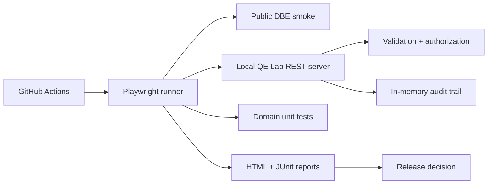

# QE Lab Architecture

The lab is in-memory and stateless across CI runs; it is not an actual banking platform. No production credentials are sent to GitHub Actions.

## Engineering tradeoffs
- Small in-memory server: predictable training fixture, no database dependency.
- Independent domain functions: easy to unit test without browser.
- Explicit negative cases: demonstrate risk coverage.
- No external LLM calls in CI: reproducibility and zero API-key exposure.
